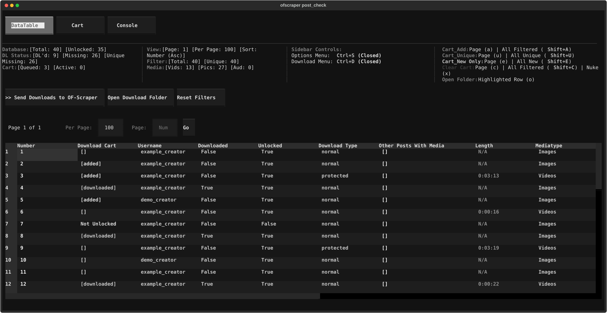

<div align="center">


# OF-Scraper-Community

**Download what you're subscribed to on OnlyFans and Fansly, from the command line.**

A community-maintained fork of [datawhores/OF-Scraper](https://github.com/datawhores/OF-Scraper), with the fixes users have reported since upstream stopped updating.

[](https://github.com/cloakedkeys/OF-Scraper-Community/releases/latest)
[](https://github.com/cloakedkeys/OF-Scraper-Community/actions/workflows/codecov.yml)
[](https://codecov.io/gh/cloakedkeys/OF-Scraper-Community)
[](#install)
[](https://github.com/cloakedkeys/OF-Scraper-Community/pkgs/container/of-scraper-community)
[](https://cloakedkeys.gitbook.io/ofsc)
[](https://github.com/cloakedkeys/OF-Scraper-Community/blob/main/LICENSE)

[Install](#install) · [Getting started](#getting-started) · [Docs](https://cloakedkeys.gitbook.io/ofsc) · [FAQ](#faq) · [Reference](https://github.com/cloakedkeys/OF-Scraper-Community/blob/main/reference/README.md) · [Releases](https://github.com/cloakedkeys/OF-Scraper-Community/releases) · [Report a problem](#reporting-a-problem)

</div>

---

> **OF-Scraper can't get past paywalls.** You need a subscription to a creator, and you can only download what your account can already see.

## Why this fork

Upstream hasn't been updated since April 2026. This fork keeps it working:

| | |
|---|---|
| 🔐 **DRM video** | Protected videos download and decrypt again, with ffmpeg 6, 7 and 8+. |
| 🌐 **Fansly** | Posts, messages, purchases, labels (profile walls) and livestreams, alongside OnlyFans. |
| 🐍 **Python 3.11 to 3.15** | Tested in CI on the oldest and newest supported versions. |
| 🛠️ **Bug fixes** | Dozens of reported bugs fixed, with tests that guard them. See the [releases](https://github.com/cloakedkeys/OF-Scraper-Community/releases). |
| 📖 **Full reference** | Every command, option, setting and database table [documented](https://github.com/cloakedkeys/OF-Scraper-Community/blob/main/reference/README.md). |

## Install

This fork is on PyPI as **`ofscraper-community`**. The command is still `ofscraper`.

**Requirements:**
- Python 3.11 or higher.
- ffmpeg 6 or newer, only for protected (DRM) videos.

**With uv (recommended)**

```sh
uv tool install ofscraper-community
```

**With pipx**

```sh
pipx install ofscraper-community
```

**With pip**

```sh
pip install ofscraper-community
```

**Without Python:** download the Windows, macOS or Linux build from the [latest release](https://github.com/cloakedkeys/OF-Scraper-Community/releases/latest).

**Docker**

```sh
docker pull ghcr.io/cloakedkeys/of-scraper-community:latest
```

### Updating

Run the command that matches how you installed it:

```sh
uv tool upgrade ofscraper-community
pipx upgrade ofscraper-community
pip install -U ofscraper-community
```

### Installed as `ofscraper`?

[datawhores/OF-Scraper](https://github.com/datawhores/OF-Scraper) releases this same code to PyPI as `ofscraper`. The two packages are released separately, so either one can be a version ahead of the other for a while. Version 3.14.7 and older are upstream's old code, without these fixes.

- **To keep `ofscraper`:** update it with `uv tool upgrade ofscraper`, `pipx upgrade ofscraper`, or `pip install -U ofscraper`.
- **To switch to `ofscraper-community`:** both packages install the same `ofscraper` command, so keep only one:
  1. Uninstall `ofscraper` using the tool you installed it with:
     - **pip:** `pip uninstall ofscraper`
     - **uv** (including the fork installed from GitHub before it was on PyPI): `uv tool uninstall ofscraper`
     - **pipx:** `pipx uninstall ofscraper`
  2. Install `ofscraper-community` as above. If pip already has both, uninstall both first, then install `ofscraper-community` again.

### Unreleased changes

To get what's on `main` before it's released, install from this repo. To update, run the same command again.

```sh
uv tool install --force git+https://github.com/cloakedkeys/OF-Scraper-Community
pip install git+https://github.com/cloakedkeys/OF-Scraper-Community
```

## Getting started

Run `ofscraper` and follow the prompts. The first run asks for your auth details and creates a config file in `~/.config/ofscraper/`.

📖 **[Read the docs](https://cloakedkeys.gitbook.io/ofsc)** for setup, auth, config options, commands and the full [technical reference](https://cloakedkeys.gitbook.io/ofsc/reference-and-help/reference).

## Check table

The check table lists a creator's media so you can filter it, pick what you want and download only that. It's for OnlyFans only.



### Opening it

- **From the menu:** run `ofscraper`, choose **Perform Action(s)**, then **Browse and pick media (check table)**. Pick the creators, then the table: **Posts**, **Messages**, **Paid**, or **Stories**. When you close the table, any downloads you sent from it finish, then you're back at the menu.
- **From the command line:** run `ofscraper post_check`, `msg_check`, `paid_check`, or `story_check`, with `-u` (usernames, or links for `post_check` and `msg_check`) or `-f` (a file with one entry per line).

The menu uses the commands' defaults: a creator's saved post list when there is one, and for Posts the Timeline, Pinned, Archived, and Streams areas. To fetch a fresh list or pick other areas, use the command with `--force` or `--check-area`.

### Tabs

- **DataTable:** every media item, a page at a time. Click a column header to sort by it.
- **Cart:** what you've picked. The **Download Text** and **Text Only (Skip Media)** boxes apply to the next send.
- **Console:** the log, including download progress.

### Sidebars (DataTable tab)

- **Ctrl+S** opens the options sidebar with filters for: text, media ID, post ID, post media count, price, post date, length, downloaded, unlocked, media type, response type, download type, and username. Press **Filter** to apply them. **Clear Filters**, or the **Reset Filters** button, clears them.
- **Ctrl+D** opens the download sidebar to set the minimum and maximum file size to download. Changes apply right away.
- Press the same key again to close a sidebar.
- With a cell highlighted, press `;` or `'` to copy its value into that column's filter, then press **Filter** to apply it.

### Cart keys (DataTable tab)

These shortcuts work when both sidebars are closed:

| Key | Adds to the cart |
|---|---|
| `a` / `Shift+A` | This page / everything the filters show |
| `u` / `Shift+U` | Same, but each media item once |
| `e` / `Shift+E` | Same, but only media that isn't downloaded yet |

| Key | Removes from the cart |
|---|---|
| `c` / `Shift+C` | This page / everything the filters show |
| `x` | Everything |

- **Mouse:** click a row's **Download Cart** cell to add or remove it, or click the **Download Cart** header to add the page.
- **Cart tab:** click `[added]` to remove a row, press `c` to remove the page, or press `x` / `Shift+C` to empty the cart.

Locked media can't be added, by key or by mouse.

### Downloading

Press **>> Send Downloads to OF-Scraper** (on the DataTable or Cart tab). The table switches to the Console, and each row's **Download Cart** cell shows `[downloading]`, then `[downloaded]`, `[skipped]`, or `[failed]`. You can keep picking and send more while it downloads.

### Opening the download folder

- Press `o` (DataTable tab, sidebars closed) to open the highlighted row's folder. For a downloaded file, that opens the folder holding it, with the file selected where the file manager supports it. Otherwise it opens the creator's download folder.
- Click **Open Download Folder** to open the highlighted row's creator's download folder.

Press **Ctrl+Q** to close the table.

## FAQ

<details>
<summary><b>Auth keeps failing, or it says "Double check auth info"</b></summary>

- Copy every value (`sess`, `auth_id`, `x-bc`, `user_agent`) again from the same browser while you're logged in to OnlyFans. They expire when you log out.
- `user_agent` must match that browser exactly.
- Make sure you're on the latest version of this fork.
- To stop the auth prompt from looping, add `--auth-fail` and the run quits on an auth error instead.

</details>

<details>
<summary><b>"No accounts found during scan"</b></summary>

Usually an auth problem, so check the auth answer above first. Then check you have an active subscription to the model, and that you aren't filtering it out with options like `--expired-subscription`.

</details>

<details>
<summary><b>Protected videos don't download, or leave <code>.part</code> / <code>tempvid</code> files</b></summary>

These videos need a CDM to decrypt them.

- Set up `cdm_options` in your config. See the [CDM guide](https://cloakedkeys.gitbook.io/ofsc/setup/cdm-options).
- Install ffmpeg 6 or newer and put its full path in `binary_options` → `ffmpeg`.
- Paths copied with Windows' "Copy as path" (with quotes) work.

</details>

<details>
<summary><b>Files download fine but are counted as "failed"</b></summary>

Fixed in 3.15.0. This mostly happened when saving to a mapped or network drive. Update to the latest version.

</details>

<details>
<summary><b>Some messages or new posts are missing</b></summary>

A bug that skipped messages when using `--after` is fixed in 3.15.0. Update, then run again. To rescan a date range, add `--after YYYY-MM-DD`. Add `--force-all` as well if you want files you already have downloaded again.

</details>

<details>
<summary><b>ffmpeg isn't found even though it's installed</b></summary>

Put the full path to the ffmpeg program in `binary_options` → `ffmpeg` in your config, for example `C:\ffmpeg\bin\ffmpeg.exe`. An empty setting means "not set".

</details>

<details>
<summary><b>It says to update to 3.14.7</b></summary>

3.14.7 is the last of upstream's old `ofscraper` releases on PyPI, and it's older than this fork's code. Version 3.15.0 and later no longer show that message. From 3.16.2 the update check looks up `ofscraper-community`; from 3.17.0 it looks up the package you installed (`ofscraper-community`, or `ofscraper`, which `datawhores/OF-Scraper` now publishes from the same code).

</details>

<details>
<summary><b>Two files saved with the same name overwrote each other</b></summary>

Newer versions save the second one as `name_<media_id>` instead. To recover files lost to this in older versions, see [Collision Recovery](https://github.com/cloakedkeys/OF-Scraper-Community/blob/main/COLLISION_RECOVERY.md).

</details>

## Fork-only features

- **Skip a model during `--scrape-paid`:** `--excluded-username` now works with `--scrape-paid`. Separate several names with commas.

  ```sh
  ofscraper --scrape-paid --excluded-username modelname,othermodel
  ```

- **Start the next daemon pass early (Docker/Linux):** while the daemon is waiting between passes, send `SIGUSR1`.

  ```sh
  docker kill --signal=SIGUSR1 <container>
  ```

- **Organize downloads in Stash:** copy each download's creator, date, caption and source into [Stash](https://stashapp.cc). See [Stash](https://github.com/cloakedkeys/OF-Scraper-Community/blob/main/STASH.md).
- **Keep the database in PostgreSQL:** as an option, one PostgreSQL database can replace the per-creator SQLite files. See [PostgreSQL](https://github.com/cloakedkeys/OF-Scraper-Community/blob/main/POSTGRESQL.md).
- **Record OnlyFans livestreams:** `--live` records the selected creators who are live now, and `--live-watch` keeps checking and records them as they go live. OnlyFans streams are recorded in a Chromium browser, so install the optional extra first: `pip install "ofscraper-community[live]"`, then `playwright install chromium`. Recordings are saved as `.webm` under `OnlyFans/{username}/Livestreams/`. Based on [cjb900](https://github.com/cjb900)'s Live Stream Monitor plugin.
- **A run summary on your phone:** `--discord SUMMARY` sends one Discord message per run (or daemon pass) instead of log lines, for example `OnlyFans, main_profile: 12 creators, 47 new files (1.8 GB), 2 failed. Took 14 min.`, followed by a line per creator that got new files. The same summary reaches `post_script` as the `summary` key of its JSON input (`site`, `profile`, `started`, `finished`, `outcome`, `totals`, `creators`, `per_creator`), so a short script can forward it anywhere else. For example, to [ntfy](https://ntfy.sh):

  ```python
  #!/usr/bin/env python3
  import json, sys, urllib.request

  s = json.load(sys.stdin)["summary"] or {}
  d = s.get("totals", {}).get("downloads", {})
  new = d.get("videos", 0) + d.get("audios", 0) + d.get("photos", 0)
  text = f"{s.get('outcome')}: {new} new files, {d.get('failed', 0)} failed"
  urllib.request.urlopen("https://ntfy.sh/your-topic", data=text.encode())
  ```

- **Alerts when something needs you:** when the login is rejected, the free-space limit is reached, or a daemon pass fails, a short alert goes to Discord (at any `--discord` level except `OFF`) and to `alert_script` (`--alert-script`), which gets `kind`, `message`, `site` and `profile` as JSON. Each is sent when it starts and again when it's fixed, not on every pass. A login rejected partway through a run stops that pass with exit code 3.

- **Move a creator's files after a rename:** move the files saved under a creator's old name to their current name's folder, and update the database to match. See [Moving files](https://github.com/cloakedkeys/OF-Scraper-Community/blob/main/MOVING_FILES.md).

## Exit codes and scheduled runs

OF-Scraper exits with a code that scripts, cron jobs and Task Scheduler can check. When more than one problem happens during a run, the most severe code wins:

| Code | Meaning |
|---|---|
| `0` | Everything ran. Skipped files are fine. |
| `4` | Partial: at least one creator, area or download failed. |
| `5` | Site unavailable (OnlyFans maintenance). Try again later. |
| `3` | Login failed (`--auth-fail` or an unreadable auth file). |
| `6` | Configuration error (unreadable config, or a configured database that can't be reached). |
| `1` | Unexpected error. |
| `2` | Usage error (command-line mistake). |
| `130` | Interrupted with Ctrl+C. |

In `--daemon` mode, each pass logs its outcome and resets for the next pass; stopping the daemon with `SIGTERM` exits `0`. Outside the daemon, `SIGTERM` isn't caught: the signal ends the run, and a shell reports `143`.

Example cron job (every 3 hours, with `--auth-fail` so it never hangs waiting for a prompt):

```sh
0 */3 * * *  ofscraper --action download -u ALL -o all -p normal --no-rich --auth-fail || echo "ofscraper exited with status $?"
```

## Reporting a problem

Open an issue [in this repo](https://github.com/cloakedkeys/OF-Scraper-Community/issues), not upstream's.

Include a debug log. Run with `--log debug`, then attach the newest file from `~/.config/ofscraper/logging/`. Check it for personal details before posting.

The GUI is a separate project: [cjb900/OF-Scraper-GUI](https://github.com/cjb900/OF-Scraper-GUI).

## Disclaimer

This tool isn't affiliated with, endorsed by or sponsored by OnlyFans or Fansly. All OnlyFans trademarks belong to Fenix International Limited. You use it at your own risk and are responsible for how you use it.

## Credits

OF-Scraper was created by [datawhores](https://github.com/datawhores) and its contributors. This fork builds on their work.

OnlyFans livestream recording is based on the Live Stream Monitor plugin by [cjb900](https://github.com/cjb900) ([OF-Scraper-GUI](https://github.com/cjb900/OF-Scraper-GUI)).
